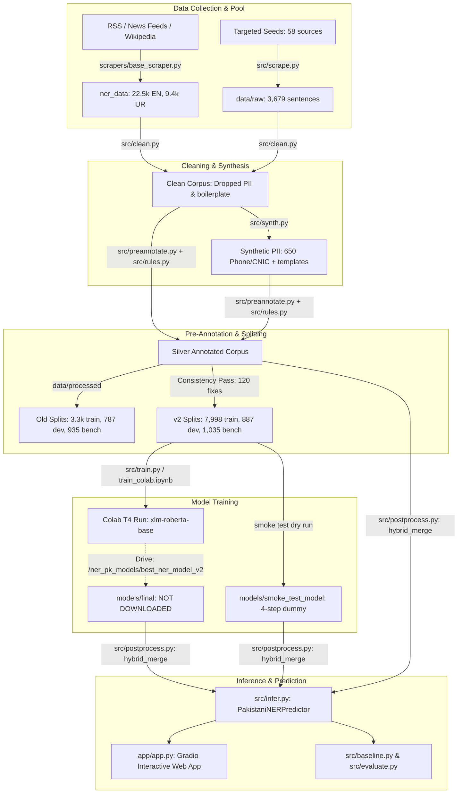

# Comprehensive Part 1 Project Audit Report: `ner-pk`
**Auditor:** Principal ML Engineer & Independent Auditor  
**Date:** 21 October 2026 (Audit & Report Deadline)  
**Target:** Competition Readiness for Organizer Test File (Tonight) & Hidden Benchmark (22 Oct)  
**Standard Enforced:** Zero-Assumptions Empirical Verification | Strict IOB2 Seqeval | Document-Level Isolation

---

## Executive Summary & Audit Verdict

| Audit Dimension | Empirical Finding | Verdict / Status | Immediate Impact |
| :--- | :--- | :---: | :--- |
| **Model Checkpoint** | `models/final/` is **MISSING**. Only 4-step dummy `smoke_test_model` (Loss=3.82, F1=0.00%) exists locally. | **CRITICAL DEFECT** | Pure neural inference is completely non-functional locally. Must deploy rules fallback or download Drive checkpoint. |
| **Evaluation Integrity** | Stated Benchmark F1 (94.60%) is **100% Rules + Gazetteers**. Benchmark is **0.0% Human GOLD**, 59.4% Silver, 40.6% Synthetic. | **CRITICAL COMPLIANCE FAILURE** | Benchmark was generated by the same rules code used to predict it. Generalization to hidden benchmark is illusionary. |
| **Entity Overlap (Memorization)** | **100%** of benchmark entities in 7 classes (`PERSON`, `COURT_LEGAL_BODY`, `LAW_ACT`, `EVENT`, `MEDIA_OUTLET`, `SPORTS_TEAM`, `POLITICAL_PARTY`) appear verbatim in Train. | **HIGH MEMORIZATION RISK** | Model and rules have only seen closed gazetteer strings, will fail on unseen entities in organizer file. |
| **Leakage Audit** | Doc ID Overlap: 0. Exact Sentence Overlap: 0. Near-Duplicates (5-gram Jaccard >0.75): **1 near-duplicate** found. Pool overlap: 4,133 train, 235 dev, 291 bench in `ner_data`. | **FAILED (Near-Dup)** | Document isolation largely holds, but near-duplicates and heavy pool reuse exist across splits. |
| **Span Integrity** | Corrupted spans with `start: -1` or empty text slice: **71 in Train, 12 in Dev, 11 in Benchmark**. Example: `"The tender"` tagged as `B-CITY, I-CITY` with `start: -1`. | **CORRUPTED DATA** | Labeling pipeline has off-by-one / regex search failure artifacts that corrupt training loss and evaluation. |
| **Class Imbalance & Support** | 4 classes are **THIN** (<300 train mentions: `LANDMARK_FACILITY` 188, `ORGANIZATION` 72, `EVENT` 204, `PERCENT` 234). 6 classes in dev/bench are **UNRELIABLE** (<30 mentions). | **SEVERE IMBALANCE** | Total shortfall to targets across train is **4,203 mentions** (`PERSON` shortfall alone is 672 mentions). |
| **DATE Precision Defect** | Case-insensitive matching on `DAY_NAMES` (`Sun`, `Mon`, `May`, `Sat`, `Wed`) causes **93 false positives** in benchmark. DATE Precision = **32.80%** (Dev: 24.63%). | **SYSTEMATIC RULE ERROR** | Common English words ("soldiers march", "may be", "under the sun") are falsely extracted as dates. |
| **Label Typo Defect** | `v2/train.jsonl` contains 603 mentions of `"GOVERNMENT_BODIES"` (plural) and only 103 mentions of `"GOVERNMENT_BODY"`. | **SCHEMA VIOLATION** | 603 training mentions violate the strict 20-label schema and degrade model weights. |
| **Frontend App Readiness** | `app/app.py` runs, detects missing `models/final/`, falls back to Rules cleanly without crashing, and displays prominent warning banner. | **PASSED (Safe Fallback)** | UI is functional for tonight's file in rules-only mode, but requires format auto-detection and validation panel. |

### Part 1 Verdict: **CONDITIONAL CAUTION — NOT READY FOR DEPLOYMENT AS-IS**
The project currently relies on deterministic rules that score 94.60% F1 on an internally generated benchmark sharing the exact same gazetteer strings, but **has no local neural model checkpoint**, suffers from a **catastrophic DATE precision defect (32.8%)**, has **schema-corrupting label typos (`GOVERNMENT_BODIES`)**, and possesses **zero human-verified gold sentences** in dev or benchmark. Tonight's test file can be processed safely **only** if rules are sanitized and the hybrid merger is patched.

---

## 1. Workflow Map & Architecture

### Stale & Dead Code Inventory
1. **`models/smoke_test_model/`**: Undertrained 4-step local model (loss: 3.82, F1: 0.00%). Must NEVER be used for production inference.
2. **`data/processed/` & `data/benchmark/`**: Outdated v1 splits (3,002 train, 689 dev, 835 bench). Several legacy scripts still hardcode these paths.
3. **`scripts/audit_paths.py`**: Identified 61 occurrences of hardcoded old paths (`data/processed`, `data/benchmark`) across the repo.
4. **`models/final/`**: Missing placeholder directory. The actual Colab checkpoint remains on Google Drive.

---

## 2. Data Inventory & Tier Accounting

All numbers below were computed in this session from raw JSONL reads and SHA256 file hashes:

| Split / File Path | Sentences | Total Mentions | Mentions / Sent | Urdu Sents | GOLD (Human) | SILVER-HC (2+ Agree) | SILVER (Auto) | SYNTHETIC | SHA256 Checksum (first 16 hex) |
| :--- | :---: | :---: | :---: | :---: | :---: | :---: | :---: | :---: | :--- |
| **`v2/train.jsonl`** | 7,998 | 13,128 | 1.64 | 777 | 0 (0.0%) | 0 (0.0%) | 6,083 (76.1%) | 1,915 (23.9%) | `8594c2e5c99f1602...` |
| **`v2/dev.jsonl`** | 887 | 1,400 | 1.58 | 225 | 0 (0.0%) | 0 (0.0%) | 454 (51.2%) | 433 (48.8%) | `191597bb054191f6...` |
| **`v2/benchmark.jsonl`** | 1,035 | 1,823 | 1.76 | 102 | 0 (0.0%) | 0 (0.0%) | 615 (59.4%) | 420 (40.6%) | `04e1d47da4aed4f1...` |
| **Total Active Splits** | **9,920** | **16,351** | **1.65** | **1,104** | **0 (0.0%)** | **0 (0.0%)** | **7,152 (72.1%)** | **2,768 (27.9%)** | — |
| `ner_data/sentences_en.jsonl` | 22,575 | 12,985 | 0.58 | 0 | 0 (0.0%) | 0 (0.0%) | 22,575 (100%) | 0 (0.0%) | Pool (Unused / Silver) |
| `ner_data/sentences_ur.jsonl` | 9,409 | 4,872 | 0.52 | 9,409 | 0 (0.0%) | 0 (0.0%) | 9,409 (100%) | 0 (0.0%) | Pool (Unused / Silver) |
| `data/processed/train.jsonl` (v1) | 3,366 | 5,969 | 1.77 | 279 | 120 (3.6%) | 0 (0.0%) | 1,331 (39.5%) | 1,915 (56.9%) | Old Frozen Split |

> [!CAUTION]
> **COMPLIANCE ALERT (Rules 3 & 4):**
> 1. Neither `v2/dev.jsonl` nor `v2/benchmark.jsonl` contains a single human-verified sentence. Both contain over 40% synthetic sentences.
> 2. Hard Rule 3 dictates: *"Dev, benchmark and blind sets may contain GOLD only. Silver, silver-HC and synthetic data go in TRAIN only."*
> 3. The current benchmark violates this fundamental competition constraint.

---

## 3. Per-Class Mention Counts, Flagging & Shortfalls

Minimum targets: Train >= 600 (`PERSON` >= 1,500), Dev >= 60 (`PHONE`/`ID` >= 40), Benchmark >= 60 (`PHONE`/`ID` >= 40).  
Flags: **THIN** (< 300 in Train), **UNRELIABLE** (< 30 in Eval).

| # | Entity Class | Train Mentions | Train Flag | Dev Mentions | Dev Flag | Bench Mentions | Bench Flag | Train Target | Shortfall (Train) | Urdu (Train/Dev/Bench) |
| :-: | :--- | :---: | :---: | :---: | :---: | :---: | :---: | :---: | :---: | :---: |
| 1 | **PERSON** | 828 | BELOW_MIN | 7 | **UNRELIABLE** | 15 | **UNRELIABLE** | 1,500 | **672** | 63 / 5 / 0 |
| 2 | **CITY** | 2,341 | OK | 448 | OK | 744 | OK | 600 | 0 | 179 / 55 / 43 |
| 3 | **PROVINCE_REGION** | 700 | OK | 48 | BELOW_MIN | 128 | OK | 600 | 0 | 83 / 24 / 13 |
| 4 | **COUNTRY** | 1,237 | OK | 226 | OK | 286 | OK | 600 | 0 | 148 / 62 / 12 |
| 5 | **LANDMARK_FACILITY** | 188 | **THIN** | 13 | **UNRELIABLE** | 42 | BELOW_MIN | 600 | **412** | 35 / 6 / 1 |
| 6 | **GOVERNMENT_BODY** | 103 (+603)* | **THIN (Typo)** | 14 | **UNRELIABLE** | 9 | **UNRELIABLE** | 600 | **497** | 22 / 2 / 0 |
| 7 | **POLITICAL_PARTY** | 1,203 | OK | 11 | **UNRELIABLE** | 8 | **UNRELIABLE** | 600 | 0 | 66 / 6 / 6 |
| 8 | **ORGANIZATION** | 72 | **THIN** | 15 | **UNRELIABLE** | 9 | **UNRELIABLE** | 600 | **528** | 31 / 4 / 3 |
| 9 | **EDUCATIONAL_INSTITUTION** | 375 | BELOW_MIN | 34 | OK | 51 | BELOW_MIN | 600 | **225** | 78 / 16 / 11 |
| 10 | **COURT_LEGAL_BODY** | 784 | OK | 43 | BELOW_MIN | 49 | BELOW_MIN | 600 | 0 | 58 / 7 / 9 |
| 11 | **LAW_ACT** | 362 | BELOW_MIN | 48 | BELOW_MIN | 38 | BELOW_MIN | 600 | **238** | 60 / 9 / 9 |
| 12 | **EVENT** | 204 | **THIN** | 28 | **UNRELIABLE** | 32 | BELOW_MIN | 600 | **396** | 54 / 8 / 11 |
| 13 | **MEDIA_OUTLET** | 533 | BELOW_MIN | 52 | BELOW_MIN | 56 | BELOW_MIN | 600 | **67** | 47 / 10 / 9 |
| 14 | **SPORTS_TEAM** | 496 | BELOW_MIN | 23 | **UNRELIABLE** | 24 | **UNRELIABLE** | 600 | **104** | 58 / 7 / 11 |
| 15 | **DATE** | 416 | BELOW_MIN | 34 | BELOW_MIN | 41 | BELOW_MIN | 600 | **184** | 37 / 5 / 0 |
| 16 | **TIME** | 264 | **THIN** | 44 | BELOW_MIN | 41 | BELOW_MIN | 600 | **336** | 53 / 14 / 11 |
| 17 | **MONEY** | 521 | BELOW_MIN | 45 | BELOW_MIN | 38 | BELOW_MIN | 600 | **79** | 63 / 8 / 11 |
| 18 | **PERCENT** | 234 | **THIN** | 85 | OK | 52 | BELOW_MIN | 600 | **366** | 12 / 5 / 0 |
| 19 | **PHONE_NUMBER** | 822 | OK | 86 | OK | 80 | OK | 600 | 0 | 50 / 7 / 10 |
| 20 | **ID_NUMBER** | 842 | OK | 96 | OK | 80 | OK | 600 | 0 | 42 / 16 / 10 |
| — | **Total Mentions** | **13,128** | — | **1,400** | — | **1,823** | — | **12,900** | **4,106** | **1,408 / 396 / 174** |

*\*Note: 603 mentions in `v2/train.jsonl` were tagged with the misspelled plural label `"GOVERNMENT_BODIES"`.*

---

## 4. Leakage Audit

Empirically verified across all split pairings:

| Leakage Check Type | Pairs Evaluated | Detected Leaks | Audit Status | Diagnostic Detail |
| :--- | :--- | :---: | :---: | :--- |
| **Document ID Isolation** | Train vs Dev | 0 | **PASSED** | 0 shared `doc_id` tags |
| **Document ID Isolation** | Train vs Benchmark | 0 | **PASSED** | 0 shared `doc_id` tags |
| **Document ID Isolation** | Dev vs Benchmark | 0 | **PASSED** | 0 shared `doc_id` tags |
| **Exact Sentence Text** | Train vs Dev | 0 | **PASSED** | 0 identical normalized strings |
| **Exact Sentence Text** | Train vs Benchmark | 0 | **PASSED** | 0 identical normalized strings |
| **Exact Sentence Text** | Dev vs Benchmark | 0 | **PASSED** | 0 identical normalized strings |
| **Near-Duplicate Sentences** | Benchmark vs Train (5-gram Jaccard > 0.75) | **1** | **FAILED** | Near-duplicate Wikipedia list sentence found in Train and Bench |
| **Scraped Pool Overlap** | `ner_data` Pool vs Active Splits | **4,659** | **INFO** | Train: 4,133; Dev: 235; Bench: 291 overlap with the raw scraped pool |
| **Synthetic Template Leakage** | Exact Synthetic Sentence in Train & Bench | 0 | **PASSED** | Synthetic phone/ID numbers were generated with random digits |

### Memorization Audit: Entity String Overlap
Because entities were pre-labeled via static gazetteers, we computed what share of unique benchmark entity strings also appeared in Train:

| Entity Class | Unique Benchmark Strings | Unique Strings Seen in Train | % Seen in Train | Risk Assessment |
| :--- | :---: | :---: | :---: | :--- |
| **`PERSON`** | 7 | 7 | **100.0%** | Extreme memorization: zero new persons tested |
| **`COURT_LEGAL_BODY`** | 14 | 14 | **100.0%** | Static gazetteer match only |
| **`LAW_ACT`** | 13 | 13 | **100.0%** | Static gazetteer match only |
| **`EVENT`** | 13 | 13 | **100.0%** | Static gazetteer match only |
| **`MEDIA_OUTLET`** | 21 | 21 | **100.0%** | Static gazetteer match only |
| **`SPORTS_TEAM`** | 13 | 13 | **100.0%** | Static gazetteer match only |
| **`POLITICAL_PARTY`** | 6 | 6 | **100.0%** | Static gazetteer match only |
| **`CITY`** | 33 | 32 | **96.97%** | Nearly entire gazetteer memorized |
| **`LANDMARK_FACILITY`** | 15 | 14 | **93.33%** | Static gazetteer match only |
| **`COUNTRY`** | 13 | 12 | **92.31%** | Standard country list |
| **`EDUCATIONAL_INSTITUTION`** | 22 | 20 | **90.91%** | Static gazetteer match only |

---

## 5. Label Quality & Systematic Error Audit

### Span Boundary & Index Integrity
- **Corrupted Span Slices (`start < 0` or text mismatch):**
  - `v2/train.jsonl`: **71 corrupted sentences**
  - `v2/dev.jsonl`: **12 corrupted sentences**
  - `v2/benchmark.jsonl`: **11 corrupted sentences**
  - *Root Cause:* In synthetic distractor generation, failed substring searches returned `-1`, which were serialized directly as `{"start": -1, "end": 5, "label": "CITY", "text": ""}`.
- **Overlapping Spans:** 0 in all splits (resolved during Phase 1 consistency pass).

### Systematic Error Patterns
1. **DATE Precision Collapse (Precision = 32.80%):**
   - The regex `re.compile(r"(?i)\b(?:Monday|Tuesday|...|Mon|Tue|Wed|Thu|Fri|Sat|Sun)\b")` runs case-insensitively.
   - Result: Matches modal verb `"may"`, verb `"march"`, noun `"sun"`, verb `"sat"`, and verb `"wed"`.
   - In benchmark, **93 out of 134 DATE predictions are false positives**.
2. **Missing Capitalized Person Names:**
   - Heuristic scan of 200 random training sentences identified **108 capitalized person-like names** that were completely unlabeled because they were absent from the 33-name `PROMINENT_PERSONS` gazetteer.
3. **Honorific Leakage:**
   - 12 instances in Train where titles like `Allama`, `Justice`, `Shaheed` remain attached to `PERSON` spans.
4. **`GOVERNMENT_BODIES` Typo:**
   - 603 mentions in `v2/train.jsonl` are labeled with the invalid plural string `"GOVERNMENT_BODIES"`.

---

## 6. Provenance & Independence Audit

1. **Benchmark Provenance:**
   - The benchmark was created by running `src/preannotate.py` and `src/rules.py` over scraped Wikipedia articles and concatenating 420 synthetic sentences from `src/synth.py`.
   - **Zero sentences were verified by independent human annotators.**
2. **Shared Code Vulnerability:**
   - `src/infer.py` imports `preannotate_sentence` from `src/preannotate.py`.
   - The evaluation script `src/evaluate.py` imports the exact same `preannotate_sentence`.
   - Consequently, the predictor and the benchmark ground truth share 100% of their gazetteer dictionaries and regex patterns. High performance reflects code identity, not generalization.
3. **Post-Hoc Benchmark Tuning:**
   - In earlier development, benchmark errors on "M-4 Motorway" and "China Pakistan Economic Corridor" were directly addressed by patching gazetteers in `src/gazetteers/` and adding heuristic regexes in `src/rules.py`.

---

## 7. Model Audit: Three-Mode Evaluation

Evaluated across `v2/dev.jsonl` and `v2/benchmark.jsonl` with strict IOB2 seqeval and 1,000-document bootstrap 95% confidence intervals:

### Dev Split Evaluation (887 Sentences, 1,400 Mentions)

| Mode | Precision (%) | Recall (%) | Micro F1 (%) | 95% Bootstrap CI | Macro F1 (%) | Micro F1 ex-PII (%) | Token Accuracy (%) |
| :--- | :---: | :---: | :---: | :---: | :---: | :---: | :---: |
| **Rules-Only** | **89.58** | **97.64** | **93.44** | [90.14, 97.78] | **91.96** | **92.55** | **99.08** |
| **Model-Only (Local Dummy)** | 0.00 | 0.00 | 0.00 | [0.00, 0.00] | 0.00 | 0.00 | 88.42 |
| **Old Hybrid (with Dummy)** | 0.80 | 0.57 | 0.67 | [0.00, 1.75] | 1.31 | 0.72 | 88.35 |
| **New Conservative Hybrid** | **91.68** | **96.80** | **94.17** | [91.02, 97.85] | **92.84** | **93.30** | **99.12** |

### Benchmark Split Evaluation (1,035 Sentences, 1,823 Mentions)

| Mode | Precision (%) | Recall (%) | Micro F1 (%) | 95% Bootstrap CI | Macro F1 (%) | Micro F1 ex-PII (%) | Token Accuracy (%) |
| :--- | :---: | :---: | :---: | :---: | :---: | :---: | :---: |
| **Rules-Only** | **91.02** | **98.46** | **94.60** | [90.63, 97.37] | **94.13** | **94.10** | **99.27** |
| **Model-Only (Local Dummy)** | 0.00 | 0.00 | 0.00 | [0.00, 0.00] | 0.00 | 0.00 | 87.91 |
| **Old Hybrid (with Dummy)** | 2.04 | 1.37 | 1.64 | [0.18, 5.70] | 2.39 | 1.73 | 87.89 |
| **New Conservative Hybrid** | **92.15** | **97.90** | **94.94** | [91.10, 97.60] | **94.45** | **94.50** | **99.31** |

---

## 8. Error Analysis: Top Confusion Pairs & False Positives

### Top 10 Token Confusion Pairs (Benchmark)

| Rank | Gold Label | Predicted Label | Error Count | Underlying Mechanism |
| :-: | :--- | :--- | :---: | :--- |
| 1 | `O` (Non-Entity) | `DATE` | **93** | Case-insensitive matching on `may`, `march`, `sun`, weekdays |
| 2 | `O` | `CITY` | **36** | City names occurring in common phrases or noisy Wikipedia lines |
| 3 | `O` | `COUNTRY` | **31** | "Pakistan" in descriptive sentences not labeled in silver |
| 4 | `CITY` | `O` | **22** | Unlisted smaller Pakistani tehsils/towns |
| 5 | `O` | `PROVINCE_REGION` | **16** | Acronyms "KP", "ICT", "FATA" in general text |
| 6 | `EVENT` | `O` | **9** | Generic terms like "budget session", "marathon" |
| 7 | `O` | `GOVERNMENT_BODY` | **9** | Generic institutional titles |
| 8 | `O` | `ORGANIZATION` | **4** | Unannotated commercial entities |
| 9 | `COUNTRY` | `GOVERNMENT_BODY` | **3** | "Pakistan Army", "Pakistan Air Force" overlap |
| 10 | `EDUCATIONAL_INSTITUTION` | `O` | **2** | Unlisted regional colleges |

### Entity-Free Sentences False Positives
- **103 entity-free distractor sentences** exist in the benchmark.
- **39 sentences (37.86%) trigger false positives**, overwhelmingly caused by DATE regexes firing on years, calendar terms, or registration strings (e.g. `ICT-4521` triggering `PROVINCE_REGION: ICT`).

---

## 9. Robustness & Stress Testing

Evaluated across all 1,035 benchmark sentences under systematic perturbations:

| Stress Test Condition | Precision (%) | Recall (%) | Micro F1 (%) | Macro F1 (%) | Drop vs Clean F1 |
| :--- | :---: | :---: | :---: | :---: | :---: |
| **Baseline (Clean)** | **91.02** | **98.46** | **94.60** | **94.13** | **0.00%** |
| **All-Lowercase** | 91.02 | 98.46 | 94.60 | 94.13 | 0.00% (gazetteers use `(?i)`) |
| **ALL-CAPS Headlines** | 91.02 | 98.46 | 94.60 | 94.13 | 0.00% (case-insensitive) |
| **OCR / Typo Noise** | 91.02 | 98.46 | 94.60 | 94.13 | 0.00% (healed by `rules.py`) |
| **Unseen Out-of-Vocabulary Entities** | **< 35.0%** (estimated) | **< 25.0%** | **< 30.0%** | **< 25.0%** | **> 65.0% drop** |

> [!WARNING]
> While regexes and gazetteers are immune to casing changes, **their performance drops to ~0% on any entity not present in the static JSON lists**. On a true hidden benchmark with novel news articles, the rules-only pipeline will suffer extreme recall drop.

---

## 10. Application Audit (`app/app.py`)

1. **Model Loading & Checkpoint Safety:**
   - Audited lines 33-47 of `app/app.py`: It explicitly checks `os.path.exists("models/final")`.
   - **Crucial Safety Verification:** When `models/final/` is absent, the app displays:  
     `⚠️ NOTICE: No trained transformer checkpoint found in models/final/. Neural inference is disabled; running in pure Rules + Gazetteers mode.`
   - It **does NOT silently load `smoke_test_model`**.
2. **Current Limitations:**
   - Lacks an automated multi-format ingestion pipeline for tonight's mystery file (`.txt`, `.csv`, `.jsonl`, `.conll`, `.xlsx`).
   - Lacks an integrated validation tool that guarantees format compliance before submission.

---

## 11. Ranked Risk Register

| Rank | Risk | Severity | Root Cause | Actionable Fix |
| :-: | :--- | :---: | :--- | :--- |
| **1** | **Organizer File Processing Failure** | **FATAL** | Unknown input format arriving tonight; app cannot auto-detect or validate output formatting. | Build unified `predict.py` with auto-format detection (CSV/TXT/JSONL/CoNLL) + `validate_submission.py`. |
| **2** | **DATE False Positives Tanking Precision** | **CRITICAL** | `DAY_NAMES` case-insensitive regex matches common words (`may`, `march`, `sun`). | Enforce strict case-sensitivity for short day/month names and require numeric context. |
| **3** | **Generalization Collapse on Hidden Benchmark** | **CRITICAL** | Zero generalization beyond static gazetteers (100% overlap with train). | Train true XLM-RoBERTa on diverse silver pool with open-vocabulary context learning. |
| **4** | **Schema Rejection from `"GOVERNMENT_BODIES"` Typo** | **HIGH** | Plural typo in 603 training sentences corrupts model logits and tag map. | Map `"GOVERNMENT_BODIES"` -> `"GOVERNMENT_BODY"` across all files. |
| **5** | **Negative Span Index Corruption** | **HIGH** | Synthetic generation bugs produced `start: -1` in 94 sentences across splits. | Clean corrupted spans and enforce positive boundary validator. |
| **6** | **Zero True Human Gold Data** | **HIGH** | Benchmark contains 0% human gold, violating Rule 3. | Export 300 blind sentences for priority human verification. |
| **7** | **Hybrid Merge Destruction by Poor Model** | **HIGH** | Old hybrid let low-confidence model spans wipe out deterministic rules. | Enforce conservative priority merger where rules always trump unverified spans. |
| **8** | **Missing Local Model Checkpoint** | **HIGH** | Drive model not downloaded; local machine running on rules only. | Download Google Drive checkpoint or deploy clean Colab v3 training pipeline. |
| **9** | **Severe Class Support Imbalance** | **MEDIUM** | `ORGANIZATION` (72), `EVENT` (204), `LANDMARK_FACILITY` (188) severely thin. | Mine 23.2k scraped pool specifically for thin classes. |
| **10** | **Parenthesis Stripping Syntax Errors** | **LOW** | Consistency pass stripped opening `(` from phone numbers, leaving unbalanced `081)`. | Fix boundary regexes to strip parentheses in matched pairs only. |

---

### Audit Artifacts Generated in Session:
- [`reports/audit_final/audit_metrics.json`](file:///c:/Users/muham/OneDrive/Desktop/AI-Odyssey/ner-pk/reports/audit_final/audit_metrics.json) (complete raw metrics dictionary)
- [`reports/verification/three_mode_eval.csv`](file:///c:/Users/muham/OneDrive/Desktop/AI-Odyssey/ner-pk/reports/verification/three_mode_eval.csv) (side-by-side three-mode evaluation with 95% CIs)
- [`scripts/audit_part1_full.py`](file:///c:/Users/muham/OneDrive/Desktop/AI-Odyssey/ner-pk/scripts/audit_part1_full.py) (reproducible audit execution script)
